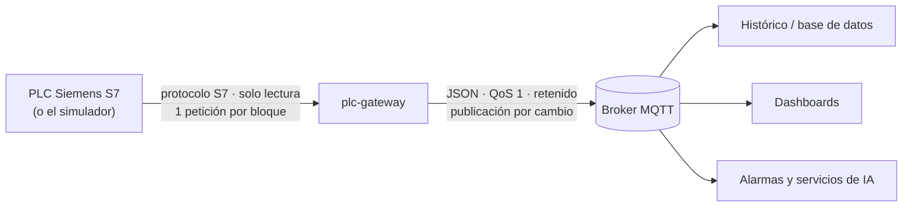

# Pasarela PLC → MQTT (Siemens S7)

[](https://github.com/aseinotegi/plc-mqtt-gateway/actions/workflows/ci.yml)


[English](README.md) · **Español**

Lee bloques de datos de un PLC Siemens S7 (S7-300/400/1200/1500) y publica cada variable en MQTT **solo cuando cambia**, con marca de tiempo, unidades y un contrato de topics estable. Se reconecta solo cuando el PLC o el broker desaparecen y nunca escribe en el PLC.

Es el primer eslabón de la cadena que monto en planta: *PLC → broker → base de datos / dashboards / IA*. Se puede probar sin hardware: incluye un PLC simulado.



## Prueba rápida (sin PLC)

```bash
docker compose up --build
```

Arranca Mosquitto, un PLC simulado, la pasarela y un suscriptor que imprime todos los mensajes. Cada dos minutos la presión simulada sube a 6,8 bar, salta la alarma y se cierra la válvula XV-104, así que se ven eventos reales:

```text
plant/line1/plc1/status/plc               {"state":"connected","ts":"2026-11-18T11:07:25.328+00:00"}
plant/line1/plc1/tags/pi_104_pressure     {"value":4.231153,"ts":"2026-11-18T11:07:25.329+00:00","unit":"bar"}
plant/line1/plc1/tags/machine_state       {"value":1,"ts":"2026-11-18T11:07:25.329+00:00"}
plant/line1/plc1/status                   {"gateway":"online"}
...
plant/line1/plc1/tags/high_pressure_alarm {"value":true,"ts":"2026-11-18T11:08:28.830+00:00"}
plant/line1/plc1/tags/valve_xv104_closed  {"value":true,"ts":"2026-11-18T11:08:30.432+00:00"}
```

Sin Docker:

```bash
pip install -e ".[dev]"
plc-sim --port 1102 &                                   # PLC simulado
PLC_PORT=1102 plc-gateway -c config/example.yaml        # necesita un broker en localhost:1883
```

## Configuración

La planta se describe en YAML con **direcciones S7 absolutas**, tal cual aparecen en TIA Portal o STEP 7:

```yaml
plc:
  host: 192.168.0.10
  rack: 0
  slot: 1            # S7-300: 2 · S7-1200/1500: 1

mqtt:
  base_topic: plant/line1/plc1
  qos: 1

gateway:
  poll_interval_ms: 200
  heartbeat_s: 60

tags:
  - { name: pump_running,    address: DB1.DBX0.0, type: BOOL }
  - { name: machine_state,   address: DB1.DBW2,   type: INT }
  - { name: pi_104_pressure, address: DB1.DBD8,   type: REAL, unit: bar, deadband: 0.05 }
```

Tipos soportados: `BOOL`, `BYTE`, `INT`, `WORD`, `DINT`, `DWORD`, `REAL`. Se comprueba que el ancho de la dirección coincide con el tipo: un `DBD` declarado como `INT` se rechaza al arrancar, no a las 3 de la mañana.

Hosts y secretos llegan por variables de entorno, nunca por el fichero: `PLC_HOST`, `PLC_PORT`, `MQTT_HOST`, `MQTT_PORT`, `MQTT_USERNAME`, `MQTT_PASSWORD`. Si alguien escribe la contraseña en el YAML, la pasarela no arranca.

> **En S7-1200/1500** el DB debe tener desactivado el *acceso optimizado al bloque* y la CPU debe permitir la *comunicación PUT/GET* (Protección y seguridad).

## Contrato de topics y mensajes

| Topic | Retenido | Contenido |
|---|---|---|
| `<base>/tags/<nombre>` | sí | `{"value": 4.23, "ts": "…+00:00", "unit": "bar"}` |
| `<base>/status` | sí | `{"gateway": "online"}` · si la pasarela muere, el broker publica `offline` (Last Will) |
| `<base>/status/plc` | sí | `{"state": "connected" \| "disconnected", "ts": "…", "error": "…"}` |
| `<base>/stats` | no | lecturas, errores, valores publicados, reconexiones, tiempo de ciclo |

Al ser mensajes retenidos, un dashboard que se conecta tarde recibe al momento el último valor de cada variable.

## Decisiones de diseño

- **Solo lectura.** La pasarela solo lee bloques de datos; no puede alterar el proceso que observa. Regla número uno en planta: no penalizar la producción.
- **Un DB para el mundo exterior.** Buena práctica: el PLC copia en un único DB dedicado todo lo que necesitan los sistemas externos, y la pasarela no toca nada más.
- **Pocas lecturas, grandes.** Las variables se agrupan en bloques contiguos que caben en una PDU S7: ocho variables cuestan una petición, no ocho. Menos carga para el procesador de comunicaciones del PLC.
- **Publicación por cambio.** Solo se publica lo que cambia. Las analógicas usan banda muerta respecto al último valor *publicado*, así que una deriva lenta acaba reportándose. En la demo, 90 segundos de lectura (449 lecturas × 8 variables) generaron 275 mensajes en lugar de 3.592.
- **Latido.** Cada `heartbeat_s`, foto completa y contadores, para que el histórico sepa que la línea sigue viva aunque nada se mueva.
- **Fallar y recuperarse a la vista.** Si el PLC cae, `status/plc` cambia una sola vez (sin inundar el log) y se reintenta con espera exponencial (1 s, 2 s, 4 s … 30 s). Al reconectar se republica todo. El cliente MQTT se reconecta solo y el Last Will avisa si la pasarela muere.

## Estructura

```text
src/plc_gateway/
  tags.py        direcciones S7, decodificación y planificación de lecturas
  config.py      YAML + entorno, validación
  plc.py         lector Snap7 (solo lectura)
  change.py      publicación por cambio con banda muerta
  gateway.py     bucle de lectura, latido, reintentos
  publisher.py   topics MQTT, Last Will, JSON
  simulator.py   PLC S7 simulado para demos y tests
tests/           tests unitarios + integración contra un servidor Snap7 real
```

## Tests

```bash
pytest -q        # 40 tests, incluida una lectura S7 real contra el simulador
ruff check .
```

La CI los ejecuta en Python 3.10–3.13 y construye la imagen Docker en cada push.

## Próximos pasos

- TLS en MQTT y configuración de certificados
- Mensajes Sparkplug B para plataformas SCADA/IIoT
- Fuente OPC UA además de S7

## Historia

La primera versión eran dos scripts que enviaban diccionarios a RabbitMQ. Se conserva en el historial ([`a8a701d`](https://github.com/aseinotegi/plc-mqtt-gateway/tree/a8a701d)); esta reescritura convierte la misma idea en un servicio configurable y probado.

---

**Ander Sein** · Ingeniero IIoT y de automatización industrial · [andersein.com](https://andersein.com) · [LinkedIn](https://www.linkedin.com/in/ander-sein-a24097195/)

Licencia MIT
