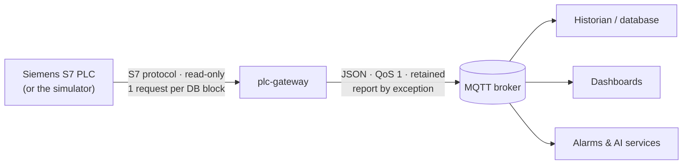

# PLC → MQTT Gateway (Siemens S7)

[](https://github.com/aseinotegi/plc-mqtt-gateway/actions/workflows/ci.yml)


**English** · [Español](README.es.md)

Reads data blocks from a Siemens S7 PLC (S7-300/400/1200/1500) and publishes every variable to MQTT **only when it changes**, with timestamps, units and a stable topic contract. It reconnects on its own when the PLC or the broker disappears and never writes to the PLC.

It is the first link of the chain I build in industrial plants: *PLC → broker → database / dashboards / AI*. Try it without hardware: a simulated PLC is included.



## Quick start (no PLC needed)

```bash
docker compose up --build
```

Starts Mosquitto, a simulated PLC, the gateway and a subscriber that prints every message. Every two minutes the simulated line pressure peaks at 6.8 bar, the alarm trips and valve XV-104 closes, so you can see real events flowing:

```text
plant/line1/plc1/status/plc               {"state":"connected","ts":"2026-11-18T11:07:25.328+00:00"}
plant/line1/plc1/tags/pi_104_pressure     {"value":4.231153,"ts":"2026-11-18T11:07:25.329+00:00","unit":"bar"}
plant/line1/plc1/tags/machine_state       {"value":1,"ts":"2026-11-18T11:07:25.329+00:00"}
plant/line1/plc1/status                   {"gateway":"online"}
...
plant/line1/plc1/tags/high_pressure_alarm {"value":true,"ts":"2026-11-18T11:08:28.830+00:00"}
plant/line1/plc1/tags/valve_xv104_closed  {"value":true,"ts":"2026-11-18T11:08:30.432+00:00"}
```

Without Docker:

```bash
pip install -e ".[dev]"
plc-sim --port 1102 &                                   # simulated PLC
PLC_PORT=1102 plc-gateway -c config/example.yaml        # needs a broker on localhost:1883
```

## Configuration

The plant layout lives in YAML using **absolute S7 addresses**, exactly as they appear in TIA Portal or STEP 7:

```yaml
plc:
  host: 192.168.0.10
  rack: 0
  slot: 1            # S7-300: 2 · S7-1200/1500: 1

mqtt:
  base_topic: plant/line1/plc1
  qos: 1

gateway:
  poll_interval_ms: 200
  heartbeat_s: 60

tags:
  - { name: pump_running,    address: DB1.DBX0.0, type: BOOL }
  - { name: machine_state,   address: DB1.DBW2,   type: INT }
  - { name: pi_104_pressure, address: DB1.DBD8,   type: REAL, unit: bar, deadband: 0.05 }
```

Supported types: `BOOL`, `BYTE`, `INT`, `WORD`, `DINT`, `DWORD`, `REAL`. The address width is checked against the type (`DBD` with `INT` is rejected at start-up, not at 3 a.m.).

Hosts and secrets come from the environment and never from the file: `PLC_HOST`, `PLC_PORT`, `MQTT_HOST`, `MQTT_PORT`, `MQTT_USERNAME`, `MQTT_PASSWORD`. A password written in the YAML is refused.

> **On S7-1200/1500** the DB must have *Optimized block access* disabled and the CPU must allow *PUT/GET communication* (Protection & Security).

## Topic and payload contract

| Topic | Retained | Payload |
|---|---|---|
| `<base>/tags/<name>` | yes | `{"value": 4.23, "ts": "…+00:00", "unit": "bar"}` |
| `<base>/status` | yes | `{"gateway": "online"}` · broker publishes `offline` via Last Will if the gateway dies |
| `<base>/status/plc` | yes | `{"state": "connected" \| "disconnected", "ts": "…", "error": "…"}` |
| `<base>/stats` | no | reads, read errors, published values, reconnects, cycle time |

Retained messages mean a dashboard that connects late immediately gets the last value of every tag.

## Design decisions

- **Read-only by design.** The gateway only reads data blocks. It cannot change the process it observes. Rule number one in a plant: never penalise production.
- **One DB for the outside world.** Recommended practice: the PLC copies everything external systems need into a single dedicated DB; the gateway touches nothing else.
- **Few, large reads.** Tags are grouped into contiguous blocks that fit in one S7 PDU, so eight tags cost one request instead of eight. Less load on the PLC's communication processor.
- **Report by exception.** Only changed values are published. Analog values use a deadband measured against the last *published* value, so slow drifts are still reported once they add up. In the demo, 90 seconds of polling (449 reads × 8 tags) produced 275 messages instead of 3,592.
- **Heartbeat.** A full snapshot and counters every `heartbeat_s`, so historians see the line is alive even when nothing moves.
- **Fail and recover visibly.** PLC down → `status/plc` changes once (no log spam) and reconnection is retried with exponential backoff (1 s, 2 s, 4 s … 30 s). After reconnecting, every tag is republished. The MQTT client reconnects by itself and Last Will reports a dead gateway.

## Project layout

```text
src/plc_gateway/
  tags.py        S7 address parsing, decoding, read planning
  config.py      YAML + environment, validation
  plc.py         Snap7 reader (read-only)
  change.py      report by exception with deadbands
  gateway.py     polling loop, heartbeat, backoff
  publisher.py   MQTT topics, Last Will, JSON payloads
  simulator.py   simulated S7 PLC for demos and tests
tests/           unit tests + integration test against a real Snap7 server
```

## Tests

```bash
pytest -q        # 40 tests, including a real S7 round-trip against the simulator
ruff check .
```

CI runs them on Python 3.10–3.13 and builds the Docker image on every push.

## Roadmap

- TLS for MQTT and certificate configuration
- Sparkplug B payloads for SCADA/IIoT platforms
- OPC UA source alongside S7

## History

The first version was a pair of scripts publishing raw dictionaries to RabbitMQ. It is kept in the git history ([`a8a701d`](https://github.com/aseinotegi/plc-mqtt-gateway/tree/a8a701d)); this rewrite turns the same idea into a configurable, tested service.

---

**Ander Sein** · IIoT & industrial automation engineer · [andersein.com](https://andersein.com) · [LinkedIn](https://www.linkedin.com/in/ander-sein-a24097195/)

MIT License
